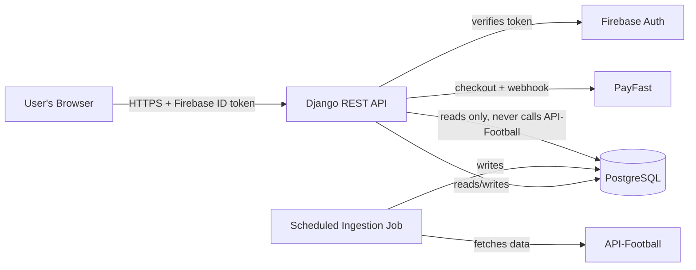

# PredictXI — System Overview

*A plain-language technical and business reference for how the platform works today: user
requests, data, caching, memberships, leagues, rate limits, and payments.*

---

## 1. What PredictXI Is

PredictXI is a football (soccer) prediction platform. Users browse fixtures across dozens of
leagues, see statistically-generated predictions and market odds, and purchase time-limited
"access passes" that unlock premium predictions. All football data (fixtures, standings, odds)
comes from a third-party provider, **API-Football** (api-sports.io). Payments are processed
through **PayFast**, a South African payment gateway. Users sign in with **Firebase
Authentication** (Google's identity service).

The system has two halves, in two separate repositories:

- **Frontend** — a React web app (`src/`, this repository, https://github.com/Shisso23/SB-APP)
  that users interact with directly: browsing fixtures, viewing predictions, and buying access.
- **Backend** — a Django REST API (https://github.com/Shisso23/PredictXI-backend) that owns all
  data, business rules, pricing, and the connection to API-Football and PayFast. The frontend
  never talks to API-Football or PayFast directly; it only ever talks to our own backend.

---

## 2. High-Level Architecture

The key design decision: **the API that serves user requests never calls API-Football
directly.** A separate, bounded background job (run manually today, see §9) is the only thing
that talks to API-Football. Every fixture, standings table, and odds quote a user sees was
fetched by that job ahead of time and stored in our own database. This has two consequences:

1. User-facing requests are fast and cheap (a database read), regardless of how many users hit
   the API at once.
2. API-Football's request quota is only consumed by the background job, which is tightly
   controlled (see §6) — never by user traffic, no matter how popular the app gets.

---

## 3. How a User Request Works

1. The user signs in with Firebase (Google/email/etc.) in the frontend. Firebase issues a short-lived
   **ID token** (a signed JWT).
2. Every request to our backend includes that token as `Authorization: Bearer <token>`.
3. The backend verifies the token's signature directly with Firebase on every request
   (`api/authentication.py` in the backend repo) — it never trusts anything in the token except the verified
   user ID. On first sign-in, a matching `User` row is created automatically.
4. Once identity is established, the request is routed to a read-only endpoint
   (fixtures, leagues, standings, odds, predictions) which queries PostgreSQL directly — **no
   live call to API-Football happens here, ever.**
5. Some endpoints require an **active prediction entitlement** (see §7) — if the user hasn't
   purchased access (and isn't staff), those return `403 Forbidden`.
6. All read responses are paginated and wrapped in a consistent envelope (`api/envelopes.py`),
   and nothing is ever double-counted or shown stale-after-write (see §4).

---

## 4. Data & Caching Model

There is **no separate cache layer** for football data — and this is intentional, not an
oversight. PostgreSQL itself acts as the cache:

- The ingestion job fetches data from API-Football and stores it once.
- Every user-facing read is a database query against that stored data.
- Because thousands of users can all query the same database rows cheaply, this already gives
  every user "free," shared caching — without any of the correctness risks of a second cache
  layer (like serving one user's request a stale response while another user has just written
  new data).

We deliberately tried adding a time-based (TTL) cache on top of this once, to reduce database
load further, and reverted it immediately: our own test suite caught a real bug where a cached
*empty* result kept being served even after fresh data was written moments later. The lesson:
any caching here must never let one user see data older than what was just written by another
part of the system. Until there's a proven *need* for an extra cache layer (e.g. real,
measured database load), we intentionally don't add one.

The only place a short-lived, in-memory cache **is** used today is for abuse protection — e.g.
rate-limiting repeated purchase attempts from the same user — which has no correctness
requirement beyond "roughly right."

**Practical implication:** data freshness is entirely controlled by how often the ingestion job
runs (§5), not by any cache expiry. If the job hasn't refreshed a league in two days, users see
two-day-old standings for that league until it runs again.

---

## 5. The Ingestion & Prediction Pipeline

A single Django management command, `run_prediction_job`, is the **only** code path allowed to
call API-Football or to generate/settle predictions. It runs in one of four modes, always
scoped to one league + one season per invocation:

| Mode | What it does |
|---|---|
| `bootstrap` | One-time historical backfill: fetches several past seasons of fixtures for a league (no standings/odds). Used once when a league is first onboarded. |
| `refresh` | The regular update: fetches current-season fixtures, the full leagues catalog, current standings, and upcoming odds. |
| `predict` | Runs the private prediction engine against upcoming fixtures (next 2 days) and stores the output. Makes no external API calls. |
| `settle` | Compares finished matches against previously-stored pre-kickoff predictions and records win/loss outcomes. Makes no external API calls. |

### Safety mechanisms (why this is "bounded")

- **One worker at a time, globally.** A PostgreSQL advisory lock ensures only one ingestion job
  process runs across the entire system at once — no two jobs can race each other.
- **Idempotent time slots.** Each job run is tagged to a 5-minute time slot; if the exact same
  slot/league/mode has already completed, re-running it is a safe no-op.
- **Checkpointed, resumable.** If a job is interrupted partway, it picks up from its last
  checkpoint rather than re-fetching everything.
- **Bounded retries.** A failed job retries with exponential backoff (2, 4, 8 minutes), up to 3
  attempts, then stops and must be re-triggered.
- **Hard per-job budget.** A single job invocation can make at most 150 provider requests
  (`PREDICTXI_JOB_REQUESTS`) and must finish within 180 seconds (`PREDICTXI_JOB_SECONDS`), or it
  aborts safely.
- **Shared daily/per-minute budget.** See §6 — these are enforced across *all* jobs, not per-job.
- **No raw provider errors ever surface** to logs or responses in a way that could leak
  credentials or internal detail — only sanitized status codes.

### Scheduling status

**Today, nothing runs this automatically.** Every `bootstrap`/`refresh`/`predict`/`settle` has
been triggered manually during setup and testing. A recurring scheduler (cron or similar) still
needs to be put in place for production — suggested cadence:

| Data | Suggested refresh frequency |
|---|---|
| Fixtures & standings | Every few hours |
| Odds | Every 15–30 minutes (they go stale fastest) |
| `predict` | Shortly before each matchday, for upcoming fixtures |
| `settle` | After matches finish (e.g. every hour) |

---

## 6. Leagues Covered & Rate Limits ("Burning Out")

### Which leagues are enabled

A single setting, `PREDICTXI_LEAGUES` (in the backend repo's `.env`), is a flat allow-list of league IDs.
**Only leagues on this list can ever be ingested or appear in the app.** This exists specifically
so the ingestion job can never accidentally fetch (and spend quota on) a league nobody asked for.

As of today, **43 leagues** are enabled, covering:

- The "big five" European top flights (England, Spain, Italy, Germany, France)
- Most of the rest of top-flight Europe (Portugal, Netherlands, Belgium, Scotland, Turkey,
  Greece, Russia, Ukraine, Austria, Switzerland, Denmark, Sweden, Norway, Poland, Czech
  Republic, Croatia, Serbia, Romania)
- The Americas (Brazil, Argentina, USA/MLS, Mexico)
- Asia (Japan, South Korea, Saudi Arabia)
- Middle East & Africa (UAE, Qatar, Egypt, South Africa, Morocco, Algeria, Tunisia, Nigeria,
  Ghana, Ivory Coast, Senegal, Cameroon, Australia)

Every one of these IDs was verified against the live API-Football catalog before being added, to
avoid silently misconfiguring a league.

### Your actual quota

The real, external limit comes from the **API-Football PRO plan: 7,500 requests/day**. Every
single HTTP call the ingestion job makes to API-Football counts against this, shared across
every league, every mode, every day — reset at UTC midnight by the provider.

### Our internal safety margins

We never rely on the provider's own 429 (quota-exceeded) response as the first line of defense.
Instead, a shared PostgreSQL counter tracks every request *before* it's sent, and refuses the
request outright once a limit is reached:

| Limit | Current value | Purpose |
|---|---|---|
| `PREDICTXI_REQUESTS_PER_DAY` | 7,000 | Stays 500 under the real 7,500/day provider cap, so our own system refuses new work before the real quota is ever hit. |
| `PREDICTXI_REQUESTS_PER_MINUTE` | 60 | Smooths out bursts (e.g. accidentally running several leagues back-to-back). |
| `PREDICTXI_JOB_REQUESTS` | 150 | Caps how many requests any *single* league+season job can make, even if something misbehaves. |

If the provider ever does return a 429 anyway, the system imposes its own 15-minute cooldown
before trying again, regardless of the counters above.

### What a refresh actually costs

Each `refresh` job (one league, one season) makes:

- 1 request for that league's current fixtures
- 1 request for the leagues catalog (shared, not per-league)
- 1 request for current standings
- Up to several requests for odds (odds are the only endpoint that paginates; in practice we've
  seen 1 page cover a league's odds, but worst case is 25 pages)

**Typical cost:** ~3–4 requests per league. **Worst case:** ~28 requests per league.

For all 43 configured leagues, a full refresh pass costs roughly **130–170 requests typically**,
or up to **~1,200 in the worst case** — either way, comfortably inside the 7,000/day budget, with
room for several full passes per day.

### What would actually cause a burn-out

The budgets above make it very hard to *accidentally* exceed the real 7,500/day cap through this
system alone. The realistic ways to actually exhaust it:

1. **An overly-frequent scheduler.** E.g. a cron job refreshing all 43 leagues every 5 minutes
   would attempt up to 288 full passes a day — that's the scenario the budgets above exist to
   prevent, and the job would simply start failing with "budget exhausted" rather than silently
   overspending.
2. **Manual/ad-hoc API calls outside this system** (e.g. testing scripts, curling API-Football
   directly with the same key) — these bypass our internal counters entirely and eat into the
   *real* provider quota invisibly. Keep any manual testing against the real key to a minimum.
3. **Adding many more leagues without adjusting cadence.** The per-league cost is roughly fixed,
   so doubling the league count roughly doubles the cost of a full refresh pass — still fine
   today, but worth revisiting if the list grows much larger or odds pagination gets more expensive.

---

## 7. Memberships & Access

### Access products (what's for sale)

Prices and durations are **data, not code** — defined in an `AccessProduct` database table, so
changing a price never requires a deployment. Current catalog:

| Product | Price | Duration |
|---|---|---|
| `predictxi_pass_1_day` | ZAR 19.00 | 1 day |
| `predictxi_pass_7_day` | ZAR 59.00 | 7 days |
| `predictxi_pass_30_day` | ZAR 149.00 | 30 days |
| `predictxi_test_7_days` | ZAR 5.00 | 7 days (pre-existing test product) |

### Entitlements (what "access" means)

A user's actual access is a separate `AccessEntitlement` row with a start and end timestamp.
Buying a pass either creates a fresh entitlement starting now, or — if the user already has one
active — **extends the existing one's end date** (so stacking two 7-day passes gives 14 days,
not two separate overlapping windows).

Every premium read (predictions, odds) checks, on every single request, whether the user has an
entitlement covering *right now*. There is no "logged in once, trusted forever" shortcut.

### Staff / admin free pass

Staff and superuser accounts (a real database flag, `is_staff`/`is_superuser` — **never** taken
from the Firebase token itself, since a token's claims could in theory be tampered with before
reaching us) always have access, with no purchase needed. This is granted via a server-side
management command (`grant_free_access <firebase_uid>`), never through any API a user could call.
The frontend sees this as a normal-looking entitlement window (effectively 50 years out), so no
special-casing is needed on the client.

### Purchases are exactly-once

Every purchase request carries a client-generated **idempotency key**. If a request is retried
(e.g. a flaky connection causes the client to resend), the backend recognizes the duplicate key
and returns the *original* outcome rather than charging or granting twice.

---

## 8. Payments (PayFast)

PredictXI uses **PayFast** (currently configured with a temporary sandbox merchant account,
clearly marked for replacement before going live) for real purchases. Three other voucher-based
providers (1Voucher, OTT, Blu) exist in the codebase but are disabled — they were never
integrated with a real provider.

### Checkout flow

1. The frontend asks our backend to start a checkout for a given **product code** (that's the
   only client input — price, currency, and every other PayFast field are set server-side, so a
   user can never manipulate what they're charged).
2. The backend returns a signed set of fields the browser auto-submits to PayFast's hosted
   payment page. No card details ever touch our server.
3. The user pays on PayFast's page, then is redirected back to a results page in our app — but
   this redirect is **UX only**. It never grants access by itself, because a user could reach
   that URL without actually paying.
4. **The only thing that ever grants access is PayFast's server-to-server notification (ITN)** —
   a POST request directly from PayFast's servers to ours, validated by four independent checks:
   cryptographic signature, source IP allow-list, a server-side confirmation call back to
   PayFast, and an amount match against what we expected to charge. Failing any one of these
   grants nothing.
5. Because ITNs can arrive out of order or be retried by PayFast itself, the same idempotency-key
   protection from §7 prevents double-granting.

---

## 9. The Prediction Engine

Predictions are generated by a private statistical engine (TypeScript, compiled and run via a
sandboxed Node subprocess with a hard 10-second timeout — never inside the request/response
cycle). It is explicitly **not** a guarantee of outcome; its design philosophy (documented in
`src/config/prediction-config.ts`) is conservative by default:

- Built on a Poisson goal model (expected goals per team, blended with league-wide and
  opponent-strength priors), with shrinkage for small sample sizes so a team's one unusual result
  can't dominate its profile.
- Different markets (match result, over/under goals, both-teams-to-score, etc.) each have their
  own minimum-probability and minimum-edge thresholds before a selection is surfaced at all —
  the engine would rather show nothing than show a low-confidence pick.
- Historical frequencies are explicitly never treated as calibrated probabilities without this
  blending/shrinkage step.
- Every prediction is generated from a **frozen snapshot** of data known at that moment (final
  scores, standings, odds) — never recomputed with hindsight, and never regenerated once a match
  has kicked off.
- A dedicated `settle` step later checks each prediction against the real final score, so
  accuracy can be measured and audited after the fact.

The frontend never runs this engine itself. `BetAndFixturesScreen` reads already-generated
forecasts from the premium `/predictions/` endpoint (filterable by fixture/league/season/date)
and only falls back to its own rule-based "legacy" mode, which carries no probabilities and is
not entitlement-gated. Because `predict` only runs for fixtures whose kickoff is within the next
48 hours, a fixture further out simply has no forecast yet; the UI reports this explicitly
("No published forecast yet") instead of inventing one client-side. A fixture that has already
kicked off keeps its last pre-match forecast (and, once `settle` runs, its real outcome) rather
than losing it.

---

## 10. Security Measures (Summary)

- **Authentication**: every request is verified against Firebase directly (not just decoded) on
  every call; tokens are never trusted blindly.
- **Authorization**: privilege (staff/admin) is read only from our own database, never from
  token claims, specifically to prevent a forged/tampered claim from granting access.
- **Payments**: price and product selection are entirely server-owned; the only thing a client
  can choose is *which* product to buy, never the amount.
- **Webhook authenticity**: PayFast's server-to-server notification is checked against four
  independent signals before being trusted.
- **No sensitive data retained**: voucher PINs, card numbers, and PayFast passphrases are never
  logged, stored, or echoed back.
- **Generic error messages**: purchase and checkout failures all return the same generic message
  regardless of cause, so a caller can't probe for which products exist, which provider is
  misconfigured, or why something failed.
- **Rate limiting**: purchase attempts are capped per user (5 per 5 minutes) independent of the
  provider-quota protections described in §6.
- **CORS**: only the known frontend origin is allowed to call the API, with an explicit,
  minimal list of permitted custom headers.

---

## 11. Current Operational Status

**Working and verified today:**
- Full read API (fixtures, leagues, standings, odds, predictions) serving from PostgreSQL.
- Ingestion pipeline (bootstrap/refresh/predict/settle) for all 43 configured leagues.
- Firebase authentication end-to-end.
- Access product catalog, entitlements, purchase idempotency.
- PayFast checkout + ITN verification (sandbox credentials).
- Staff/admin free-pass mechanism.
- Provider rate-limit/budget protection, independently verified against the real 7,500/day PRO
  plan cap.

**Not yet in place:**
- An automated recurring scheduler for the ingestion job. `scripts/run_prediction_schedule.sh`
  (in the backend repo) wraps the bounded `refresh`/`predict`/`settle` invocations for every
  allowed league into one script, but it is not installed into any cron/launchd schedule — an
  operator must deliberately enable it.
- Production PayFast merchant credentials (sandbox credentials are a temporary stand-in).
- A dedicated response-caching layer (intentionally deferred — see §4 — until there's a measured
  need).
